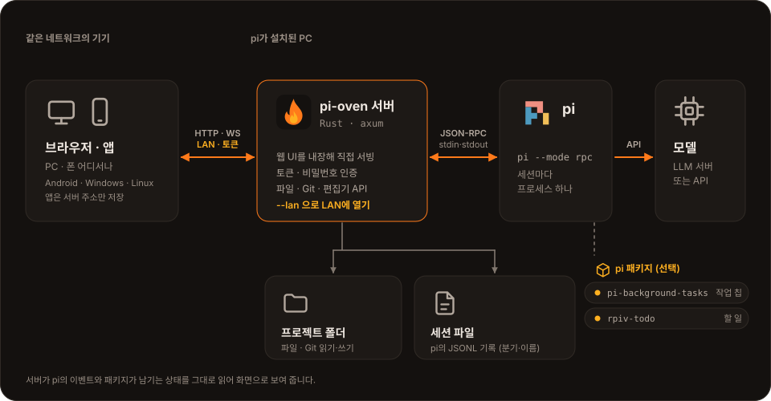
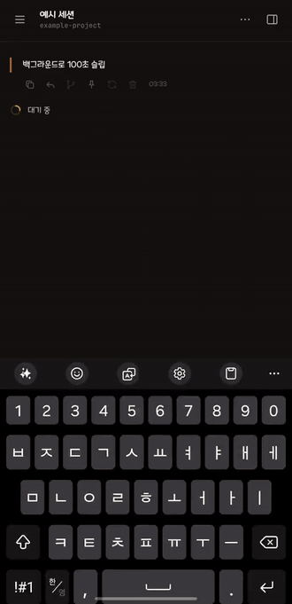
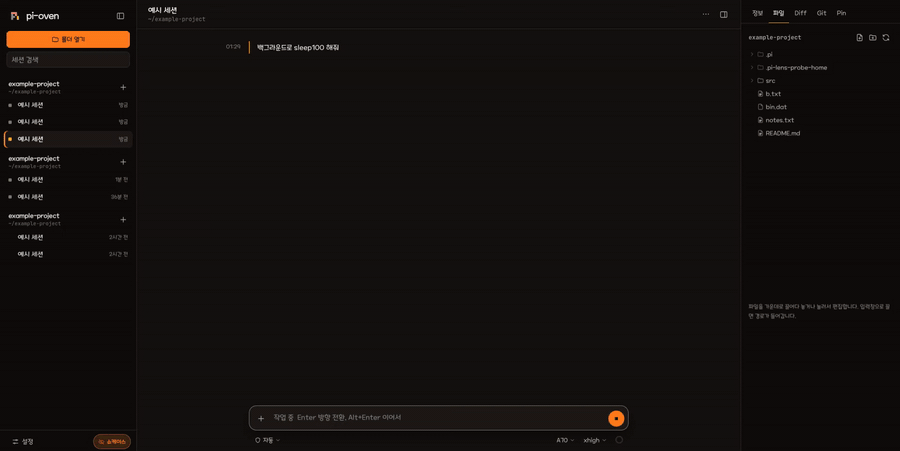

<div align="center">


# pi-oven

**A lightweight app for using the [pi](https://pi.dev) coding agent from a browser, a phone or the desktop**

[](https://github.com/snowman6-git/pi-oven/releases)
[](LICENSE)

[한국어](README.md) · **English**

[Getting started](#getting-started) · [Features](#features) · [Options](#options) · [Usage guide (Korean)](docs/USAGE.md)

</div>

<br>

A single Rust server starts `pi --mode rpc` for each session, relays it over WebSocket and serves the web UI itself. Open the server to your LAN and you can keep working in **the same session, at the same time and live**, from a PC browser, a phone and the desktop app.



<table>
<tr>
<td></td>
<td></td>
</tr>
</table>

## Getting started

Run the server on the PC where pi is installed, then connect with a browser or the app. The apps are only windows onto a server, so the server is always needed.

### 1. Server

Download `server-…-linux-x86_64.tar.gz` from [Releases](https://github.com/snowman6-git/pi-oven/releases) and unpack it:

```sh
tar xzf server-pi-oven-*-linux-x86_64.tar.gz
./pi-oven-server/pi-oven --lan
```

Or build from source (Rust stable and Node.js):

```sh
git clone https://github.com/snowman6-git/pi-oven && cd pi-oven
(cd web && npm ci && npm run build)
cargo build --release
./target/release/pi-oven --lan
```

With `--lan` and no token or password, the server makes an access token and prints it with the address. For this PC only, run it without options and open `http://127.0.0.1:4141`.

> [!WARNING]
> pi runs shell commands, so the token is as good as access to this PC. Do not expose it to the internet directly; use a VPN or an HTTPS reverse proxy. If you pick the token yourself, pass it with `--token-file` or `PI_OVEN_TOKEN` so it does not show up in `ps`.

### 2. Connect

Open the server address in a browser, or enter the server address and token once in the app.

| App ([Releases](https://github.com/snowman6-git/pi-oven/releases)) | Needs |
|---|---|
| Android `app-…-android-arm64.apk` | Android 7.0+, "install unknown apps" allowed |
| Linux `app-…-linux-x86_64.AppImage` | FUSE 2 (`fuse2` / `libfuse2`), or run with `--appimage-extract-and-run` |
| Linux `app-…-linux-x86_64-native.tar.gz` | GTK 3, `webkit2gtk-4.1` |
| Windows `app-…-windows-x64-setup.exe` | WebView2 runtime (included in Windows 10/11) |

<details>
<summary>Warnings on Linux</summary>

- `GStreamer element appsink not found`: install `gst-plugins-base` (Arch) or `gstreamer1.0-plugins-base` (Debian, Ubuntu). No media is played, so it is safe to ignore.
- `Failed to load module "…-gtk-module"`: the GTK inside the AppImage cannot find a system module. Safe to ignore.
- The AppImage runs as a native Wayland client in a Wayland session, and fcitx5 is connected through the compositor's input method (Wayland) or XIM (X11). If the window is black or typing misbehaves, try `GDK_BACKEND=x11` or `WEBKIT_DISABLE_DMABUF_RENDERER=1`, or use the native tar.gz, which uses the system libraries. `PI_OVEN_DEBUG_ENV=1` prints what the app chose.

</details>

## Features

- **Several devices at once**: open a session on a PC and a phone together and both see the stream, the tool runs and the queue. A device that reloads or joins late picks up the work in progress.
- **Chat**: streaming, tool calls with running time, image attachments and image previews in tool results, steering, follow-ups and "send now" (Ctrl+Enter) while pi works, tok/s and time to first token.
- **Permissions**: auto, or manual (write and run tools are approved on screen). The mode is kept on the server, so every device and new session uses it.
- **Sessions**: listed by folder, renamable, with a session tree to branch or regenerate (the original session is left as it was). When the server restarts, open sessions are reopened by themselves; an ended session has a "Reopen" button.
- **Work folder**: file explorer and editor (CodeMirror, notices changes on disk), Diff, Git staging and commits.
- **Pins**: addresses and tokens from the chat in one place, plus your own regex rules.
- **Adding models**: an endpoint and key are saved to pi's `models.json` (backed up first).
- **Showcase mode**: for sharing your screen, blurs or replaces paths, addresses, tokens, file names and more.
- **Languages**: Korean and English. It follows the browser language and can be changed in Settings or with the globe button under the session list. Server errors follow the page's language; the terminal messages and `--help` follow the system locale (`LANG`). Adding one JSON file (`web/src/locales/<code>.json`) adds a language ([how](web/src/locales/README.md)).
- **About**: the About tab in Settings shows the pi version, the installed packages with their versions, and the MCP servers (name, transport, tool count). MCP commands, addresses and keys are never sent to the page.

### pi packages that add to the UI

Each part appears only when its package is installed.

| Package | Adds |
|---|---|
| [`pi-background-tasks`](https://www.npmjs.com/package/pi-background-tasks) | Background task chips with running time, completion notices, a task list |
| [`@juicesharp/rpiv-todo`](https://www.npmjs.com/package/@juicesharp/rpiv-todo) | A to-do tray above the message box |
| [`pi-updater`](https://www.npmjs.com/package/pi-updater) | An "Update available" card under the session list instead of a dialog in every new session; one click runs `pi update` on the server |

## Options

| Option | Meaning |
|---|---|
| `--host <addr>`, `--port <port>` | Address and port to listen on (default `127.0.0.1:4141`) |
| `--lan` | Same as `--host 0.0.0.0` |
| `--token <value>`, `--token-file <file>` | Access token (12+ characters). Made for you when opened to the LAN without a token or password |
| `--password <value>`, `--password-file <file>` | Password typed on the sign-in page (8+ characters). Works together with a token |
| `--trust-proxy` | Behind a reverse proxy, count failed sign-ins per client |
| `--allow-origin <origin>` | Another browser origin allowed to call the API (repeatable) |
| `--pi-bin <path>`, `--pi-arg <arg>` | The pi to run, and an argument for every pi process |
| `--sessions-dir <dir>` | pi's session folder (default `~/.pi/agent/sessions`) |
| `--no-permission-ext` | Turn off the built-in permission (auto/manual) extension |

Every option can also be given as a `PI_OVEN_*` environment variable. Repeated wrong tokens or passwords lock that address out for a while. The screens and behaviour in detail are in [docs/USAGE.md](docs/USAGE.md) (Korean).

## License

[Apache License 2.0](LICENSE). Third-party notices are in [THIRD_PARTY_NOTICES.md](THIRD_PARTY_NOTICES.md) and asset terms in [ASSETS_LICENSE.md](ASSETS_LICENSE.md). The UI uses the MapleStory font provided by MapleStory.
