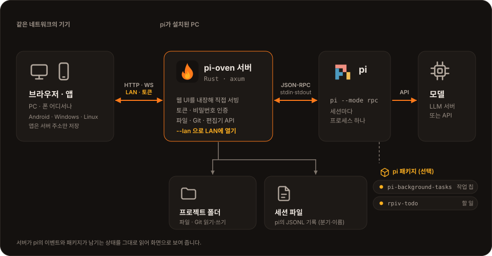
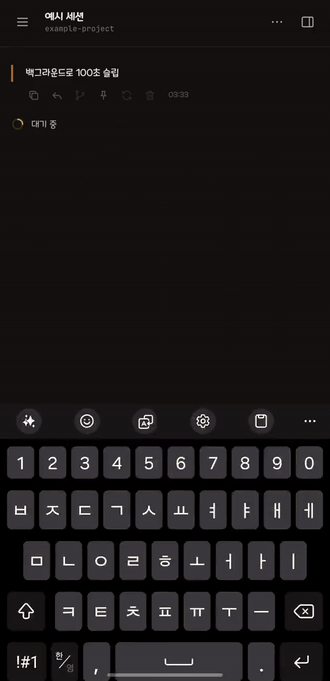
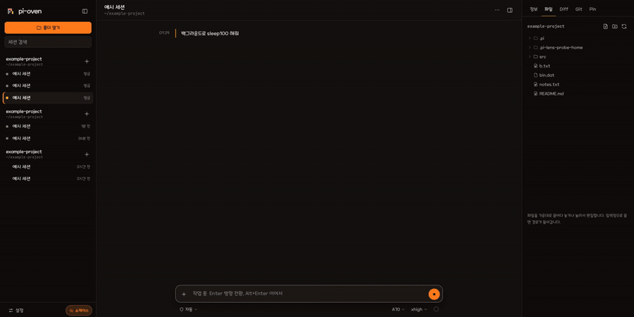

<div align="center">


# pi-oven

**[pi](https://pi.dev) 코딩 에이전트를 브라우저·폰·데스크톱에서 쓰는 가벼운 앱**

[](https://github.com/snowman6-git/pi-oven/releases)
[](LICENSE)

[시작하기](#시작하기) · [기능](#기능) · [실행 인자](#실행-인자) · [사용법 문서](docs/USAGE.md)

</div>

<br>

Rust 서버 하나가 세션마다 `pi --mode rpc`를 띄우고 WebSocket으로 중계하며, 웹 화면도 직접 내려줍니다. 서버를 LAN에 열어 두면 PC 브라우저, 폰, 데스크톱 앱에서 **같은 세션을 동시에, 실시간으로** 이어서 쓸 수 있습니다.



<table>
<tr>
<td></td>
<td></td>
</tr>
</table>

## 시작하기

pi가 설치된 PC에서 서버를 띄우고, 브라우저나 앱으로 접속합니다. 앱은 서버에 연결하는 창일 뿐이라 서버는 항상 필요합니다.

### 1. 서버

[Releases](https://github.com/snowman6-git/pi-oven/releases)에서 `server-…-linux-x86_64.tar.gz`를 받아 풀거나,

```sh
tar xzf server-pi-oven-*-linux-x86_64.tar.gz
./pi-oven-server/pi-oven --lan
```

소스에서 빌드합니다(Rust stable, Node.js 필요).

```sh
git clone https://github.com/snowman6-git/pi-oven && cd pi-oven
(cd web && npm ci && npm run build)
cargo build --release
./target/release/pi-oven --lan
```

`--lan`으로 열 때 토큰이나 비밀번호를 주지 않으면 접속 토큰을 만들어 주소와 함께 출력합니다. 이 PC에서만 쓸 거라면 인자 없이 실행하고 `http://127.0.0.1:4141`을 엽니다.

> [!WARNING]
> pi는 셸 명령을 실행하므로 토큰이 곧 이 PC의 권한입니다. 인터넷에 직접 열지 말고 VPN이나 HTTPS 리버스 프록시 뒤에서 쓰세요. 토큰을 직접 정한다면 `ps`에 보이지 않도록 `--token-file`이나 `PI_OVEN_TOKEN`을 쓰세요.

### 2. 접속

브라우저로 서버 주소를 열거나, 앱에 서버 주소와 토큰을 한 번 입력합니다.

| 앱 ([Releases](https://github.com/snowman6-git/pi-oven/releases)) | 필요한 것 |
|---|---|
| Android `app-…-android-arm64.apk` | Android 7.0 이상, "출처를 알 수 없는 앱" 허용 |
| Linux `app-…-linux-x86_64.AppImage` | FUSE 2 (`fuse2` / `libfuse2`). 없으면 `--appimage-extract-and-run` |
| Linux `app-…-linux-x86_64-native.tar.gz` | GTK 3, `webkit2gtk-4.1` |
| Windows `app-…-windows-x64-setup.exe` | WebView2 런타임 (Windows 10/11 기본 포함) |

<details>
<summary>리눅스에서 나오는 경고</summary>

- `GStreamer element appsink not found`: `gst-plugins-base`(Arch) 또는 `gstreamer1.0-plugins-base`(Debian·Ubuntu)를 설치하면 사라집니다. 미디어를 재생하지 않으므로 무시해도 됩니다.
- `Failed to load module "…-gtk-module"`: AppImage 안의 GTK가 시스템 모듈을 못 찾는 것이라 무시해도 됩니다.

</details>

## 기능

- **여러 기기 동시 사용**: 한 세션을 PC와 폰에서 같이 열면 스트리밍, 도구 실행, 대기열이 양쪽에 그대로 보입니다. 새로고침이나 늦게 연 기기도 진행 중인 작업을 이어서 받습니다.
- **대화**: 스트리밍, 도구 호출과 경과 시간, 이미지 첨부와 도구 결과 이미지 미리보기, 작업 중 방향 전환·이어서 보내기·즉시 보내기, tok/s와 TTFT
- **권한**: 자동 또는 수동(쓰기·실행 도구는 화면에서 승인). 고른 모드는 서버에 저장되어 모든 기기와 새 세션에 적용됩니다.
- **세션**: 폴더별 목록, 이름 바꾸기, 세션 트리에서 분기·다시 생성(원본 세션은 그대로)
- **작업 폴더**: 파일 탐색기와 편집기(CodeMirror, 디스크 변경 감지), Diff, Git 스테이지·커밋
- **Pin**: 대화에 나온 주소·토큰을 모아 두고, 직접 정규식 규칙을 추가
- **모델 추가**: 엔드포인트와 키를 pi의 `models.json`에 저장(저장 전 백업)
- **쇼케이스 모드**: 화면 공유용으로 경로·주소·토큰·파일 이름 등을 흐리거나 예시 글자로 바꿈

### 함께 쓰면 켜지는 pi 패키지

설치되어 있을 때만 해당 화면이 나타나고, 없으면 그 부분만 보이지 않습니다.

| 패키지 | 켜지는 것 |
|---|---|
| [`pi-background-tasks`](https://www.npmjs.com/package/pi-background-tasks) | 백그라운드 작업 칩과 실행 시간, 완료 알림, 작업 목록 |
| [`@juicesharp/rpiv-todo`](https://www.npmjs.com/package/@juicesharp/rpiv-todo) | 입력창 위의 할 일 트레이 |

## 실행 인자

| 인자 | 설명 |
|---|---|
| `--host <주소>`, `--port <포트>` | 듣는 주소와 포트 (기본 `127.0.0.1:4141`) |
| `--lan` | `--host 0.0.0.0`과 같음 |
| `--token <값>`, `--token-file <파일>` | 접속 토큰(12자 이상). LAN에 열면서 인증을 주지 않으면 자동으로 만듦 |
| `--password <값>`, `--password-file <파일>` | 접속 화면에 입력하는 비밀번호(8자 이상). 토큰과 같이 쓸 수 있음 |
| `--trust-proxy` | 리버스 프록시 뒤에서 실패 횟수 제한을 접속자별로 셈 |
| `--allow-origin <출처>` | API를 호출해도 되는 다른 브라우저 출처 (여러 번 가능) |
| `--pi-bin <경로>`, `--pi-arg <인자>` | 실행할 pi와, 모든 pi 프로세스에 넘길 인자 |
| `--sessions-dir <폴더>` | pi 세션 폴더 (기본 `~/.pi/agent/sessions`) |
| `--no-permission-ext` | 내장 권한(자동/수동) 확장을 끔 |

모든 인자는 `PI_OVEN_*` 환경변수로도 줄 수 있습니다. 틀린 토큰·비밀번호가 반복되면 그 주소는 잠시 잠깁니다. 화면 구성과 세부 동작은 [docs/USAGE.md](docs/USAGE.md)에 있습니다.

## 라이선스

[Apache License 2.0](LICENSE). 서드파티 고지는 [THIRD_PARTY_NOTICES.md](THIRD_PARTY_NOTICES.md), 에셋은 [ASSETS_LICENSE.md](ASSETS_LICENSE.md)에 있습니다. 이 프로젝트의 화면에는 메이플스토리가 제공한 메이플스토리 서체가 적용되어 있습니다.
