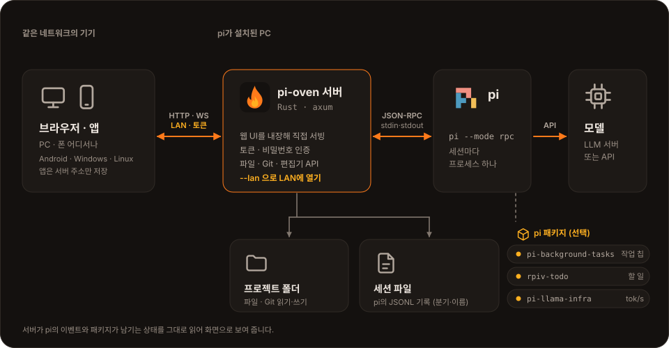
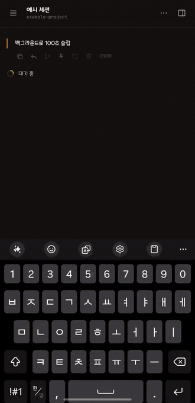
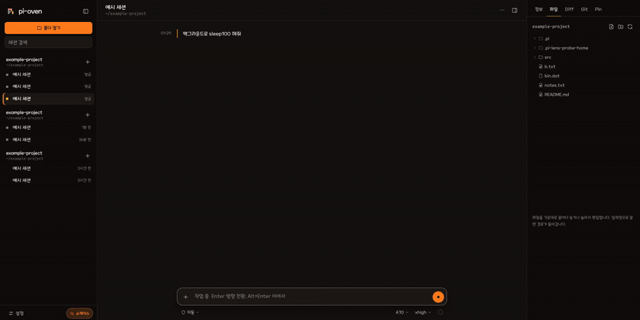

<p align="center"></p>

# pi-oven

**[pi](https://pi.dev) 에이전트용 가벼운 RPC 앱.** pi가 필요합니다.

`pi --mode rpc`를 세션마다 띄워 WebSocket으로 중계하는 Rust 서버 하나와, 그 서버가 직접 내려주는 웹 화면으로 이뤄져 있습니다. 서버를 LAN에 열어 두면 PC 브라우저, 폰, 앱에서 같은 pi 세션을 쓸 수 있습니다.



## 데모

백그라운드 작업이 칩으로 올라와 실행 시간이 올라가다가, 끝나면 알림으로 들어옵니다.

<table>
<tr>
<td></td>
<td></td>
</tr>
</table>

원본 영상: [폰 (mp4)](docs/media/background-tasks-phone.mp4) · [데스크톱 (webm)](docs/media/background-tasks-desktop.webm)

## 앱

앱은 **LAN에 열어 둔 pi-oven 서버에 연결하는 창**입니다. 서버를 대신하지 않으므로, pi가 설치된 PC에서 서버를 `--lan`으로 띄운 뒤 앱에 그 주소(와 토큰)를 한 번 입력합니다. 폰 앱은 다음부터 저장된 서버에 자동으로 연결됩니다.

내려받기: [Releases](https://github.com/snowman6-git/pi-oven/releases). 파일 이름 앞이 `app-`이면 앱, `server-`이면 서버입니다.

- `app-…-android-arm64.apk`, `app-…-linux-x86_64.AppImage`, `app-…-linux-x86_64-native.tar.gz`, `app-…-windows-x64-setup.exe`
- `server-…-linux-x86_64.tar.gz` (pi-oven 서버 바이너리. 웹 화면이 들어 있고 pi가 필요합니다. 윈도우용 서버는 아직 없습니다.)

브라우저만으로도 같은 화면을 쓸 수 있습니다(서버 주소를 열면 됩니다).

| 앱 | 필요한 것 |
|---|---|
| Android (arm64) | Android 7.0(API 24) 이상. 설치할 때 "출처를 알 수 없는 앱" 허용 |
| Linux (AppImage) | FUSE 2 (Arch `fuse2`, Debian·Ubuntu `libfuse2`). 없으면 `--appimage-extract-and-run`으로 실행. WebKit은 AppImage에 들어 있음 |
| Linux (네이티브 tar.gz, 소스 빌드) | GTK 3와 `webkit2gtk-4.1` (Arch `gtk3` `webkit2gtk-4.1`, Debian·Ubuntu `libwebkit2gtk-4.1-0`) |
| Windows (x64) | WebView2 런타임 (윈도우 10/11에는 보통 들어 있음) |

리눅스에서 `GStreamer element appsink not found` 경고가 나오면 `gst-plugins-base`(Arch)·`gstreamer1.0-plugins-base`(Debian·Ubuntu)를 설치하면 사라집니다. 이 앱은 미디어를 재생하지 않아서 없어도 동작에는 지장이 없습니다. `Failed to load module "…-gtk-module"` 같은 메시지는 AppImage 안의 GTK가 시스템의 GTK 모듈을 못 찾는 것으로, 무시해도 됩니다.

## 사용법

필요한 것: `pi`(`pi --mode rpc` 실행 가능), Rust(stable), Node.js.

```sh
git clone https://github.com/snowman6-git/pi-oven && cd pi-oven
(cd web && npm ci && npm run build)
cargo build --release
```

LAN에 열고, 접속 토큰을 정해서 서빙하는 예:

```sh
./target/release/pi-oven --lan --token 'my-secret-token-1234'
```

`http://<서버 IP>:4141/#token=my-secret-token-1234`로 접속하거나, 접속 화면에 토큰을 입력합니다. 토큰이 곧 이 PC의 권한이니, 인터넷에 직접 열지 말고 VPN이나 HTTPS 리버스 프록시 뒤에서 쓰세요. 토큰은 `ps`에 보이므로 실제로는 `--token-file`이나 환경변수 `PI_OVEN_TOKEN`을 권합니다.

### 실행 인자

| 인자 | 설명 |
|---|---|
| `--host <주소>`, `--port <포트>` | 듣는 주소와 포트 (기본 `127.0.0.1:4141`) |
| `--lan` | `--host 0.0.0.0`과 같음. 다른 기기에서 접속 |
| `--token <값>`, `--token-file <파일>` | 접속 토큰(12자 이상). `--lan`인데 인증 인자가 없으면 토큰을 만들어 출력 |
| `--password <값>`, `--password-file <파일>` | 접속 화면에서 입력하는 비밀번호(8자 이상). 토큰과 같이 쓸 수 있음 |
| `--trust-proxy` | 리버스 프록시 뒤에서 실행할 때, 실패 횟수 제한을 접속자별로 셈 |
| `--allow-origin <출처>` | API를 호출해도 되는 다른 브라우저 출처 (여러 번) |
| `--pi-bin <경로>` | 실행할 pi (기본 `pi`) |
| `--pi-arg <인자>` | 모든 pi 프로세스에 넘길 인자 (예: `--pi-arg=--approve`) |
| `--sessions-dir <폴더>` | pi 세션 폴더 (기본 `~/.pi/agent/sessions`) |
| `--no-permission-ext` | 내장 권한(자동/수동) 확장을 끔 |

틀린 토큰·비밀번호가 반복되면 접속한 주소별로 잠깁니다. 모든 인자는 `PI_OVEN_*` 환경변수로도 줄 수 있고, 자세한 설명은 `--help`와 [docs/USAGE.md](docs/USAGE.md)에 있습니다.

## 기능

pi만 있으면 되는 것:

- 대화(스트리밍, 도구 호출 표시, 입력 중 방향 전환, 이미지 첨부)와 모델·추론 강도·권한(자동/수동) 선택
- 세션 목록, 이름 바꾸기, 세션 트리에서 분기·다시 생성
- 파일 탐색기와 편집기(CodeMirror), Diff, Git(스테이지·커밋)
- 대화에서 찾은 주소·토큰을 모아 두는 Pin과 직접 쓰는 감지 규칙(정규식)
- 모델 추가(엔드포인트·키를 pi의 `models.json`에 저장)
- 화면 공유용 쇼케이스 모드(경로·주소·토큰을 가림)

pi 패키지가 있을 때 켜지는 것(없으면 그 부분만 나오지 않습니다):

| 패키지 | 켜지는 것 |
|---|---|
| [`pi-background-tasks`](https://www.npmjs.com/package/pi-background-tasks) | `bg_run` 백그라운드 작업 칩과 실행 시간, 완료 알림, 작업 목록 |
| [`@juicesharp/rpiv-todo`](https://www.npmjs.com/package/@juicesharp/rpiv-todo) | 입력창 위의 할 일 트레이 |
| [`pi-llama-infra`](https://www.npmjs.com/package/pi-llama-infra) | 답변 아래 tok/s, 프리필 중 표시 |

## 라이선스

[Apache License 2.0](LICENSE). 서드파티 고지는 [THIRD_PARTY_NOTICES.md](THIRD_PARTY_NOTICES.md), 에셋은 [ASSETS_LICENSE.md](ASSETS_LICENSE.md)에 있습니다. 이 프로젝트의 화면에는 메이플스토리가 제공한 메이플스토리 서체가 적용되어 있습니다.
